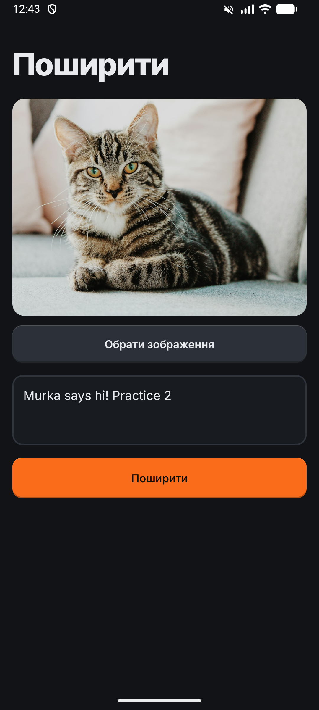
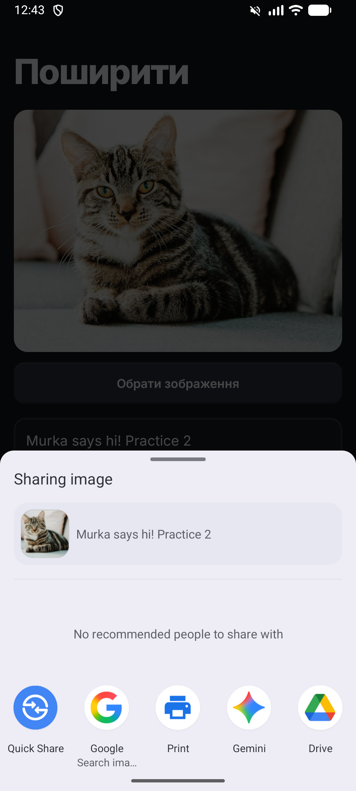

# Практика 2 — «Поширити» фото з текстом

Завдання: кнопка вибору зображення з пристрою, текстове поле і кнопка «Поширити». При натисканні на «Поширити»
з'являється системний діалог вибору додатка (Telegram тощо), і туди приходять і зображення, і текст.

| Додаток | Діалог «Поширити» |
|:---:|:---:|
|  |  |

## Як працює

- **Обрати зображення** — системний Photo Picker (`PickVisualMedia`), дозволи не потрібні.
- **Поширити** — `Intent.ACTION_SEND` з `EXTRA_STREAM` (фото) і `EXTRA_TEXT` (текст з поля),
  загорнутий у `Intent.createChooser(...)`. Фото спершу копіюється в кеш і віддається через `FileProvider`
  з `FLAG_GRANT_READ_URI_PERMISSION`, щоб Telegram та інші додатки мали до нього доступ.

Код: [`MainActivity.kt`](app/src/main/java/com/example/android_proj/MainActivity.kt) (функція `share()`).

## Запуск

Android Studio → **Run** (Android 13 / API 33+), або `./gradlew installDebug` (JDK 21).
