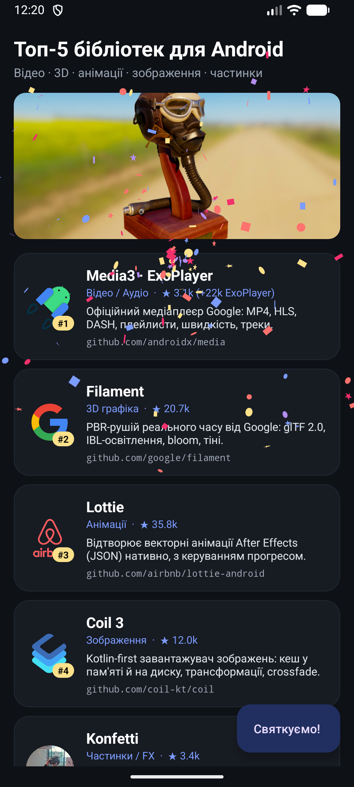
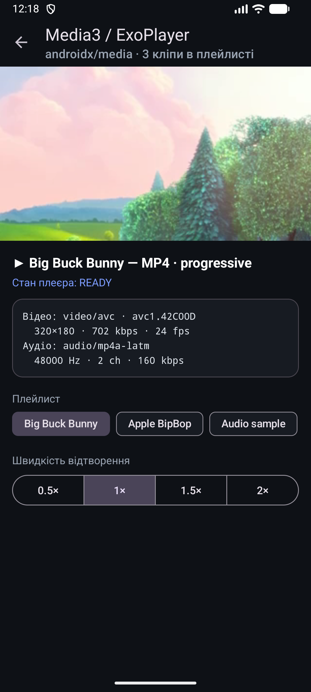
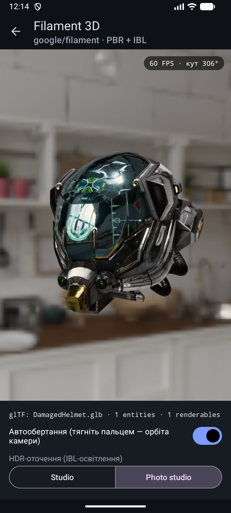
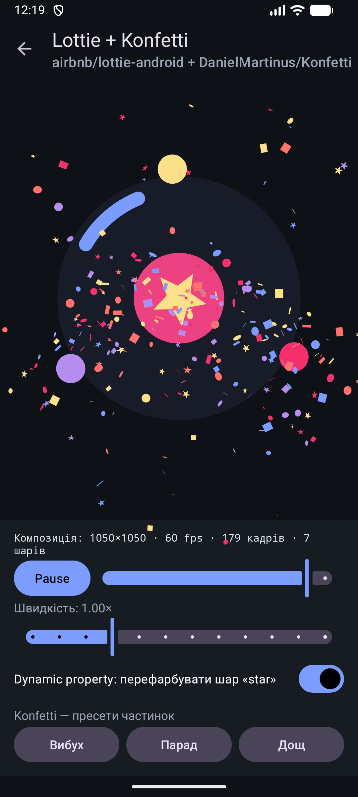

# android-dev — Топ-5 сторонніх бібліотек для Android

Навчальний проєкт: дослідження сучасних корисних open-source бібліотек для Android (відео, аудіо, 3D, анімації, зображення),
вибір топ-5, підключення кожної **строго за інструкцією з README її репозиторію** та демонстрація корисних можливостей у
робочому застосунку.

| Головна (Coil + Konfetti) | Media3 / ExoPlayer | Filament 3D | Lottie + Konfetti |
|:---:|:---:|:---:|:---:|
|  |  |  |  |

---

## 1. Як проводилось дослідження

1. **Генерація кандидатів нейромережею.** За допомогою AI-асистента (нейромережі) складено довгий список популярних
   Android-бібліотек у категоріях «відео/аудіо», «3D-графіка», «анімації», «зображення», «UI-ефекти».
2. **Перевірка фактів, а не «пам'яті» моделі.** Для кожного кандидата через GitHub API (`gh api repos/<owner>/<repo>`)
   перевірено кількість зірок, дату останнього коміту, архівність і ліцензію, а через `maven-metadata.xml` у
   Maven Central / Google Maven — актуальну версію артефакту (станом на 12.11.2026).
3. **Критерії відбору:** активна підтримка (коміти у 2026 р.), стабільний реліз у Maven, ліцензія Apache-2.0/ISC,
   робота з View-based (XML) проєктом без Compose, реальна користь для різних медіа-задач (щоб топ-5 не дублював одне одного).

### Довгий список кандидатів

| Бібліотека | Репозиторій | ★ | Останній push | Рішення |
|---|---|---:|---|---|
| **Lottie** | [airbnb/lottie-android](https://github.com/airbnb/lottie-android) | 35.8k | 2026-02 | ✅ топ-5 |
| **Filament** | [google/filament](https://github.com/google/filament) | 20.7k | 2026-11 | ✅ топ-5 |
| **Coil 3** | [coil-kt/coil](https://github.com/coil-kt/coil) | 12.0k | 2026-11 | ✅ топ-5 |
| **Konfetti** | [DanielMartinus/Konfetti](https://github.com/DanielMartinus/Konfetti) | 3.4k | 2026-11 | ✅ топ-5 |
| **Media3 (ExoPlayer)** | [androidx/media](https://github.com/androidx/media) | 3.1k (+22k у старому google/ExoPlayer) | 2026-11 | ✅ топ-5 |
| MPAndroidChart | PhilJay/MPAndroidChart | 38.2k | 2026-10 | ❌ останній реліз 3.1.0 — 2019 р., лише JitPack |
| uCrop | Yalantis/uCrop | 12.1k | 2025-08 | ❌ вузька задача (кадрування), немає ліцензії в API |
| Shimmer | facebook/shimmer-android | 5.3k | 2023-03 | ❌ репозиторій архівовано |
| Oboe | google/oboe | 4.1k | 2026-11 | ❌ C++/NDK, для навчального демо надто низькорівнева |
| SceneView | sceneview/sceneview | 1.4k | 2026-11 | ❌ надбудова над Filament, Compose-first — обрано сам Filament |

### Топ-5

| # | Бібліотека | Категорія | Що вміє | Версія |
|---|---|---|---|---|
| 1 | **AndroidX Media3 / ExoPlayer** | Відео / аудіо | MP4, HLS, DASH, плейлисти, швидкість, вибір треків, ABR | `1.11.1` |
| 2 | **Google Filament** | 3D-графіка | PBR-рендеринг у реальному часі, glTF 2.0, IBL, bloom, SSAO | `1.80.1` |
| 3 | **Airbnb Lottie** | Анімації | Векторні анімації After Effects (JSON), керування прогресом, dynamic properties | `6.7.1` |
| 4 | **Coil 3** | Зображення | Завантаження з мережі, кеш у пам'яті/на диску, трансформації, crossfade | `3.6.3` |
| 5 | **Konfetti** | Частинки / FX | Система частинок: вибух, парад, дощ, власні форми (зірки) | `2.2.0` |

---

## 2. Підключення (за README кожного проєкту)

Усі версії винесено в `gradle/libs.versions.toml`, залежності — у `app/build.gradle.kts`.

| Бібліотека | Що сказано в README | Як зроблено в проєкті |
|---|---|---|
| Media3 | «add Gradle dependencies on the libraries you need… All modules must be the same version», увімкнути Java 8+ | `media3-exoplayer`, `media3-exoplayer-hls`, `media3-ui` з одним `version.ref = "media3"`; Java 21 |
| Filament | `implementation 'com.google.android.filament:filament-android:…'` з `mavenCentral()`; для glTF — `gltfio-android`, для утиліт — `filament-utils-android`; «You must always first initialize Filament» | три артефакти однієї версії + `Utils.init()` у `companion object` |
| Lottie | `implementation 'com.airbnb.android:lottie:$lottieVersion'` (проєкт на AndroidX) | `com.airbnb.android:lottie:6.7.1`, `LottieAnimationView` у XML |
| Coil 3 | «Import the … library and a networking library» (`coil-network-okhttp`) | `io.coil-kt.coil3:coil` (View-версія) + `coil-network-okhttp`; розширення `ImageView.load()` |
| Konfetti | «View based (XML) project: `nl.dionsegijn:konfetti-xml:2.2.0`» | `konfetti-xml`, `KonfettiView` поверх екрана, конфіг через `Party` |

```kotlin
// app/build.gradle.kts
implementation(libs.media3.exoplayer)
implementation(libs.media3.exoplayer.hls)
implementation(libs.media3.ui)
implementation(libs.filament.android)
implementation(libs.filament.gltfio)
implementation(libs.filament.utils)
implementation(libs.lottie)
implementation(libs.coil)
implementation(libs.coil.network.okhttp)
implementation(libs.konfetti.xml)
```

---

## 3. Що використано з кожної бібліотеки

### Media3 / ExoPlayer — [`PlayerActivity.kt`](app/src/main/java/com/example/android_proj/PlayerActivity.kt)
- `ExoPlayer` + `PlayerView` (готовий UI з контролами);
- плейлист із 3 різних джерел: **MP4** (progressive), **HLS** (adaptive bitrate, `MimeTypes.APPLICATION_M3U8`), **MP3** (лише аудіо),
  `MediaMetadata` (назва/опис) для кожного елемента;
- перемикання треків плейлиста (`seekTo(index, 0)`), швидкість відтворення `setPlaybackSpeed(0.5…2×)`;
- `Player.Listener`: стан плеєра, перехід між треками, **реальний формат, що декодується** (`videoFormat`/`audioFormat`:
  кодек, роздільність, бітрейт, fps) і кількість якостей у HLS-потоці (ABR);
- `DefaultRenderersFactory.setEnableDecoderFallback(true)` + власний `MediaCodecSelector`;
- коректний життєвий цикл: створення плеєра в `onStart`, звільнення в `onStop` зі збереженням позиції.

### Filament — [`FilamentActivity.kt`](app/src/main/java/com/example/android_proj/FilamentActivity.kt)
- `ModelViewer` (з `filament-utils`) + `SurfaceView`, рендер у `Choreographer.FrameCallback`;
- завантаження **glTF 2.0 (GLB)** моделі «Damaged Helmet» з assets через `gltfio`;
- **Image-Based Lighting**: HDR-панорама → `HDRLoader` → `IBLPrefilterContext.EquirectangularToCubemap` →
  `SpecularFilter` → `IndirectLight` + `Skybox`; перемикання двох HDR-оточень (кешуються);
- постобробка: bloom, SSAO, FXAA, dynamic resolution;
- автообертання моделі через `TransformManager` + орбіта камери жестами (manipulator `ModelViewer`), лічильник FPS.

### Lottie — [`LottieActivity.kt`](app/src/main/java/com/example/android_proj/LottieActivity.kt)
- `LottieAnimationView` з анімацією [`res/raw/orbit_loader.json`](app/src/main/res/raw/orbit_loader.json) (7 шарів: shape-layers,
  trim paths, polystar, анімовані кольори/масштаб/обертання);
- метадані композиції (`LottieComposition`: розмір, fps, кадри, шари);
- Play/Pause, ручний скрабінг прогресу (`progress`), швидкість (`speed`);
- **Dynamic properties**: перефарбування шару `star` у рантаймі через `KeyPath("star", "**")` + `LottieProperty.COLOR_FILTER`;
- слухач повторів анімації — кожен 3-й цикл запускає конфеті.

### Coil 3 — [`MainActivity.kt`](app/src/main/java/com/example/android_proj/MainActivity.kt), [`GalleryActivity.kt`](app/src/main/java/com/example/android_proj/GalleryActivity.kt)
- `ImageView.load(url) { … }` для банера, аватарів власників репозиторіїв (`github.com/<owner>.png`, Coil сам іде за редиректом)
  і для галереї рендерів Filament;
- трансформації `CircleCropTransformation`, `RoundedCornersTransformation`, `crossfade`, `placeholder`;
- `listener(onSuccess = …)` + `SingletonImageLoader.get(context).memoryCache` — розмір кешу в пам'яті показується в тулбарі.

### Konfetti — [`Ui.kt`](app/src/main/java/com/example/android_proj/Ui.kt)
- `KonfettiView` поверх контенту; три пресети `Party`: **вибух**, **парад** (два емітери з боків), **дощ** (`Position.between`);
- форми `Shape.Square`, `Shape.Circle`, `Shape.Polygon.STAR`, власна палітра, `Emitter(...).perSecond()/max()`.

---

## 4. Проблеми, які довелося розв'язати

| Проблема | Причина | Рішення |
|---|---|---|
| `Class 'Party' was compiled with an incompatible version of Kotlin… metadata 2.4.0` | Konfetti 2.2.0 зібрано Kotlin 2.4, а вбудований у AGP 9 Kotlin — 2.2 | KGP `2.4.21` додано на classpath (`alias(libs.plugins.kotlin.android) apply false`) — AGP 9 використовує його компілятор |
| `Cannot inline bytecode built with JVM target 21 into … JVM target 11` | Kotlin-math у `filament-utils` 1.80 зібрано під JVM 21 | `sourceCompatibility/targetCompatibility = JavaVersion.VERSION_21` |
| Нативний SIGSEGV у Filament після побудови IBL | знищення `IBLPrefilterContext`/фільтрів одразу після використання | контекст створюється один раз (`by lazy`), оточення кешуються |
| Модель не видно, фон «риб'яче око» | `setLensProjection()` у `ModelViewer` залишав вироджену проєкцію (far = 1 м) | щокадрово `camera.setProjection(45°, aspect, 0.05, 100, VERTICAL)` |
| `Decoder failed: c2.goldfish.h264.decoder` на емуляторі | апаратний H.264-декодер емулятора падає посеред потоку | власний `MediaCodecSelector`: на емуляторі goldfish-декодери в кінці списку, на реальних пристроях порядок за замовчуванням |
| `targetSdk 37` — edge-to-edge завжди | системні бари накладаються на контент | `enableEdgeToEdge(SystemBarStyle.dark(...))` + відступи з `WindowInsets` |

---

## 5. Запуск

Вимоги: Android Studio (AGP 9.5), JDK 21, Android SDK 37, пристрій/емулятор з Android 13+ (minSdk 33) та OpenGL ES 3.0, інтернет
(відео та зображення завантажуються з мережі).

```bash
./gradlew :app:installDebug
```

Структура:

```
app/src/main/
├── java/com/example/android_proj/
│   ├── MainActivity.kt      # головна: список топ-5 (Coil) + конфеті (Konfetti)
│   ├── PlayerActivity.kt    # Media3 / ExoPlayer
│   ├── FilamentActivity.kt  # Filament 3D
│   ├── LottieActivity.kt    # Lottie + Konfetti
│   ├── GalleryActivity.kt   # Coil 3 — галерея з трансформаціями
│   ├── Libraries.kt         # дані дослідження (топ-5)
│   └── Ui.kt                # edge-to-edge, тулбар, пресети Konfetti
├── assets/models/DamagedHelmet.glb
├── assets/envs/*.hdr
└── res/raw/orbit_loader.json
```

## 6. Ресурси та ліцензії

- 3D-модель **Damaged Helmet** — © theblueturtle_, [CC BY 4.0](https://creativecommons.org/licenses/by/4.0/),
  з [KhronosGroup/glTF-Sample-Assets](https://github.com/KhronosGroup/glTF-Sample-Assets/tree/main/Models/DamagedHelmet).
- HDR-оточення `studio_small_09`, `brown_photostudio_02` — [Poly Haven](https://polyhaven.com), CC0.
- Відео: Big Buck Bunny (© Blender Foundation, CC BY 3.0) і Apple BipBop — з тестових наборів Media3/Apple, відтворюються з мережі.
- Lottie-анімація `orbit_loader.json` створена для цього проєкту.
- Бібліотеки: Media3, Filament, Lottie, Coil — Apache-2.0; Konfetti — ISC.
