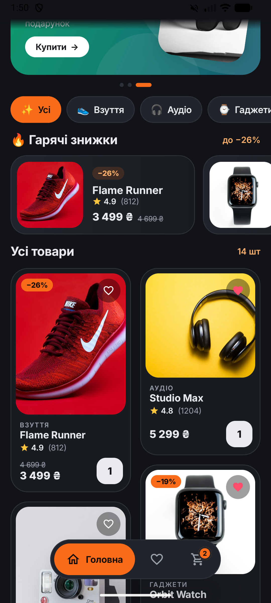
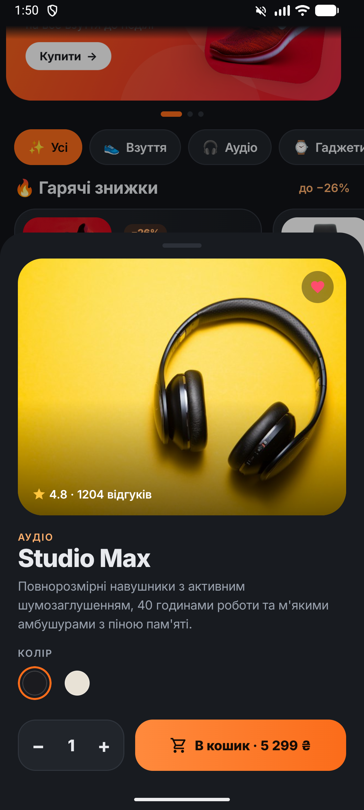
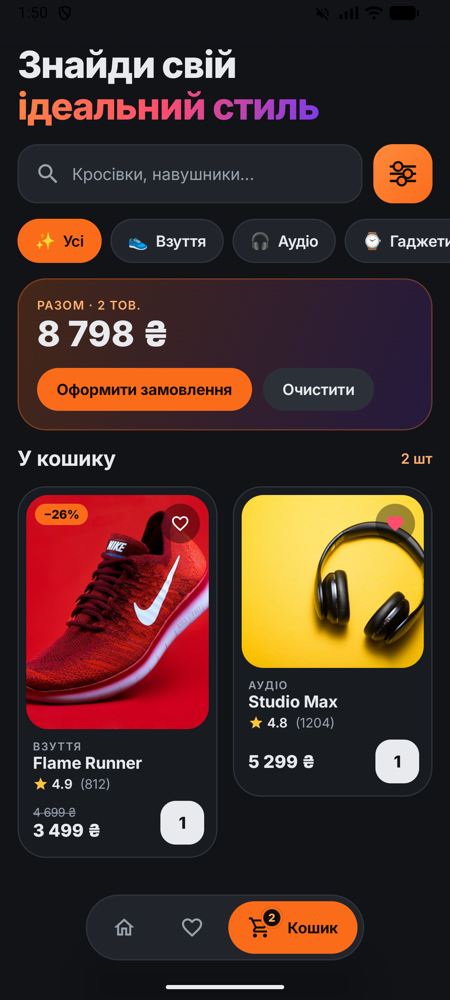

# Практика 3 — складна Compose-верстка (інтернет-магазин)

Завдання: скласти промт для нейромережі, щоб вона зробила супер-складну та красиву верстку на **Jetpack Compose**
(код на Kotlin, без XML-розмітки) для додатку на будь-яку тему. Тема — інтернет-магазин з картками товарів.

| Головна | Каталог | Товар | Кошик |
|:---:|:---:|:---:|:---:|
|  |  |  |  |

## Промт

> Ти — senior Android-розробник і UI-дизайнер. Зроби на **Jetpack Compose (Kotlin, Material 3)** головний екран
> інтернет-магазину «Vibe Store» (взуття, аудіо, гаджети, одяг, аксесуари). **Жодного XML-layout** — увесь UI
> лише composable-функціями. Темна тема, акцентний колір #FB6C1A, поверхні #111317 / #181B20 / #21252B,
> шрифт Inter, великі заокруглення (20–28 dp), інтерфейс українською.
>
> Екран має бути **один скрол** — `LazyVerticalStaggeredGrid` на 2 колонки, де верхні блоки займають всю ширину:
> 1. Шапка: аватар з градієнтом, привітання, кнопки сповіщень і кошика з **анімованим лічильником**.
>    Великий заголовок «Знайди свій ідеальний стиль», друга частина — **градієнтний текст**.
> 2. Пошук: власне поле на `BasicTextField` з плейсхолдером і кнопкою очищення, поруч кнопка фільтрів
>    з іконкою, **намальованою на Canvas**.
> 3. Промо-карусель: `HorizontalPager` з градієнтними банерами, фото товару з поворотом і **паралаксом** при свайпі,
>    сусідні сторінки видно по краях, **автопрогортання** кожні 4 с, індикатор-«пігулка», що розтягується.
> 4. Категорії: горизонтальний ряд чипів з емодзі, вибраний чип плавно перефарбовується.
> 5. «Гарячі знижки»: горизонтальний список карток зі знижкою, старою (закресленою) і новою ціною.
> 6. Сітка товарів **різної висоти** (staggered): фото, бейдж знижки, кнопка «в обране» з **пружинною анімацією**
>    серця, категорія, назва, рейтинг, ціни, кнопка «+», яка після додавання показує кількість (AnimatedContent).
>    Картка трохи стискається при натисканні. Поява/зникнення карток при фільтрації — анімовані (`animateItem`).
> 7. Плаваюча нижня навігація-«пігулка» (Головна / Обране / Кошик): активна вкладка розгортається з підписом,
>    на кошику бейдж з кількістю.
> 8. Натискання на товар відкриває `ModalBottomSheet`: велике фото з градієнтом і рейтингом, опис, вибір кольору
>    (кола з кільцем), вибір розміру, лічильник кількості з анімацією цифр і кнопка «В кошик · сума».
>
> Логіка: фільтр за категорією і пошуком, обране і кошик у стані Compose, вкладка «Кошик» показує підсумок
> з анімованою сумою. Фото товарів завантажуй з мережі через Coil 3 (`AsyncImage` з crossfade).
> Розбий код на файли: тема, дані, екран. Код має компілюватися без помилок.

## Що вийшло

Усе зроблено на Compose, XML лишився тільки для теми вікна (фон до першого кадру).

| Файл | Що всередині |
|---|---|
| [`MainActivity.kt`](app/src/main/java/com/example/android_proj/MainActivity.kt) | `setContent { ShopTheme { ShopApp() } }` |
| [`shop/ShopScreen.kt`](app/src/main/java/com/example/android_proj/shop/ShopScreen.kt) | увесь екран: шапка, пошук, карусель, категорії, знижки, сітка, нижня навігація, bottom sheet |
| [`shop/Products.kt`](app/src/main/java/com/example/android_proj/shop/Products.kt) | товари, категорії, промо-банери |
| [`shop/Theme.kt`](app/src/main/java/com/example/android_proj/shop/Theme.kt) | кольори cennge-ui, шрифт Inter, `MaterialTheme` |

Використано: `LazyVerticalStaggeredGrid` з `StaggeredGridItemSpan.FullLine`, `HorizontalPager`, `LazyRow`,
`ModalBottomSheet`, `AnimatedContent`, `AnimatedVisibility`, `animateColorAsState`, `animateDpAsState`,
`Animatable` + `spring`, `graphicsLayer` (паралакс, масштаб), `Canvas`, градієнтні `Brush`, власний `Modifier.layout`
(ряди на всю ширину екрана), Coil 3 `AsyncImage`.

## Запуск

Android Studio → **Run** (Android 13 / API 33+, потрібен інтернет для фото), або `./gradlew installDebug` (JDK 21).

Фото товарів — [Unsplash](https://unsplash.com) (Unsplash License), завантажуються з мережі. Назви товарів вигадані.
