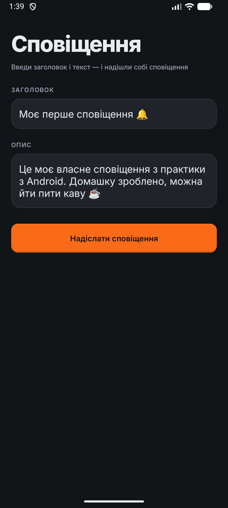
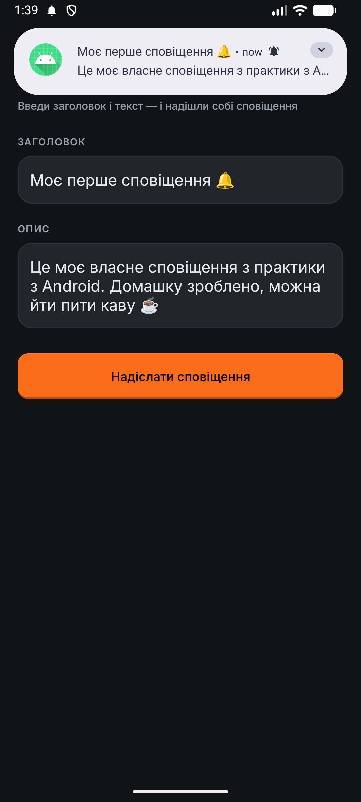
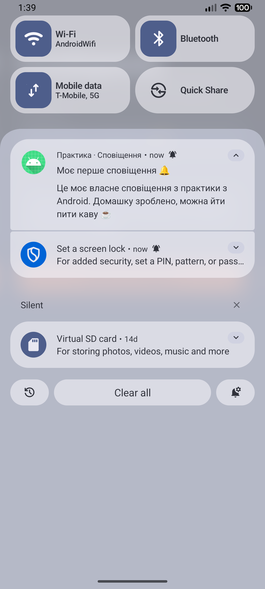

# Практика — сповіщення

Завдання: запустити приклад створення сповіщення, поставити свій текст і свій опис, надіслати скрін.

| Застосунок | Спливаюче сповіщення | У шторці |
|:---:|:---:|:---:|
|  |  |  |

## Рішення

Код — [`MainActivity.java`](app/src/main/java/com/example/android_proj/MainActivity.java) (Java):

- `NotificationChannel` з `IMPORTANCE_HIGH` (канал обов'язковий з Android 8);
- дозвіл `POST_NOTIFICATIONS` (Android 13+) — у маніфесті й запит під час виконання;
- `NotificationCompat.Builder`: свій заголовок (`setContentTitle`) і опис (`setContentText` +
  `BigTextStyle`, щоб довгий текст було видно повністю), іконка-дзвіночок, натискання відкриває застосунок;
- заголовок і опис беруться з полів вводу.

## Запуск

Android Studio → **Run** (Android 13 / API 33+), або `./gradlew installDebug` (JDK 21).
