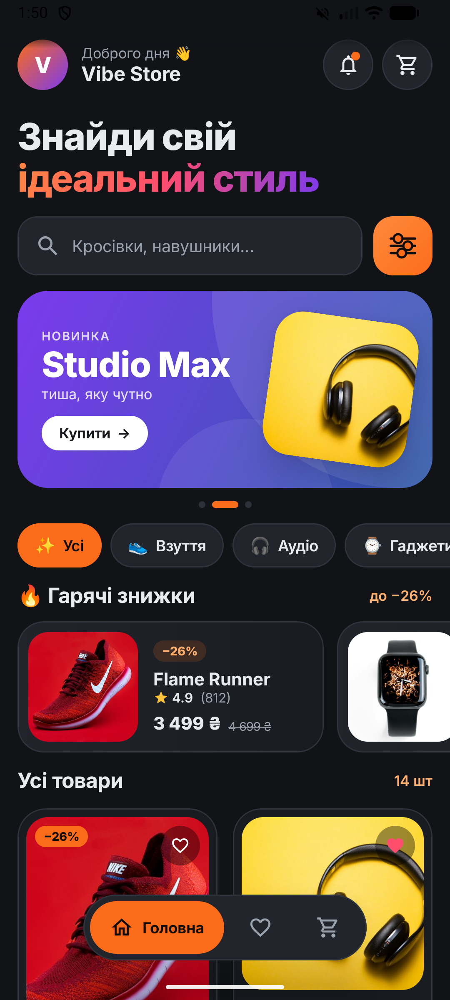
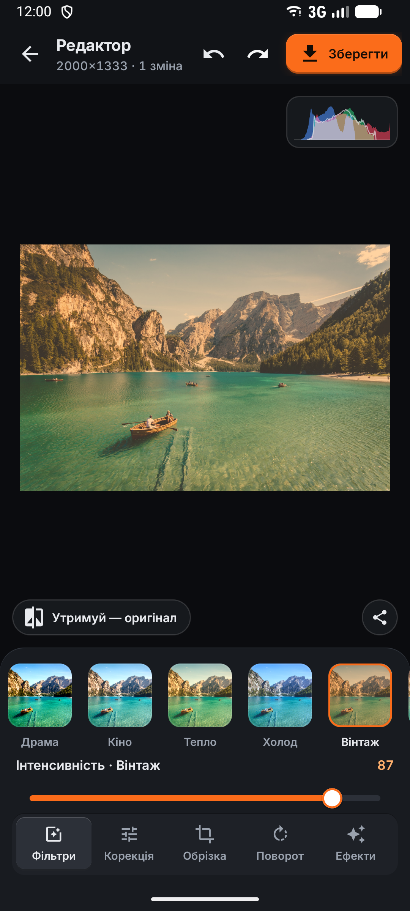
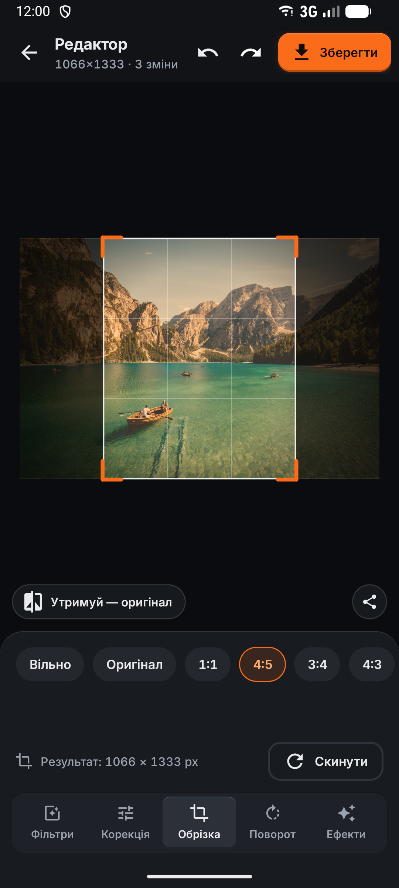

# Фотошоп 2.0 — фоторедактор для Android

Продовження практичного проєкту з заняття. Застосунок дозволяє **зробити фото камерою** (на фізичному пристрої),
**обрати його з галереї** або **завантажити з інтернету за посиланням** (зручно на емуляторі), а потім відредагувати:
15 фільтрів, 8 корекцій кольору, обрізка з 8 форматами, поворот, дзеркало, вирівнювання горизонту, 7 ефектів,
скасування/повторення, порівняння з оригіналом, гістограма та збереження в галерею.

Дизайн побудовано на дизайн-системі [cennge-ui](https://github.com/Cennge/cennge-ui): темна тема, шари поверхонь,
«тактильні» кнопки, помаранчевий акцент і шрифт Inter.

| Головний екран | Фільтри | Обрізка |
|:---:|:---:|:---:|
|  |  |  |

## Гілки репозиторію

Кожне завдання лежить в окремій гілці, у `main` — найновіша домашня робота.

| Гілка | Завдання |
|---|---|
| [`hw02-photoshop`](https://github.com/Cennge/android-dev/tree/hw02-photoshop) (= `main`) | ДЗ 2 — «Фотошоп 2.0», фоторедактор |
| [`hw01-top5-libraries`](https://github.com/Cennge/android-dev/tree/hw01-top5-libraries) | ДЗ 1 — топ-5 Android-бібліотек |
| [`practice01-cat`](https://github.com/Cennge/android-dev/tree/practice01-cat) | Практика 1 — клас `Cat`, збереження стану при повороті (`Parcelable`) |
| [`practice02-share`](https://github.com/Cennge/android-dev/tree/practice02-share) | Практика 2 — вибір фото, текст і «Поширити» |
| [`practice03-compose`](https://github.com/Cennge/android-dev/tree/practice03-compose) | Практика 3 — інтернет-магазин на Jetpack Compose |

## Що було на занятті і що додано

На занятті: фото з камери або з інтернету і 2–3 кнопки з фільтрами.

У домашній роботі додано:

| Розділ | Можливості |
|---|---|
| **Джерела фото** | камера (`TakePicture` + `FileProvider`), галерея (системний Photo Picker, без дозволів), посилання на зображення, 8 прикладів-фото |
| **Фільтри** (15) | Яскравий, Драма, Кіно, Тепло, Холод, Вінтаж, Кодахром, Технікольор, Полароїд, Мат, Сепія, Ч/Б, Нуар, Нічне бачення, Негатив; живі мініатюри кожного фільтра на вашому фото і повзунок інтенсивності |
| **Корекція** (8) | експозиція, яскравість, контраст, насиченість, температура, відтінок, тон (обертання hue), вицвітання |
| **Обрізка** | рамка з кутовими ручками і сіткою третин; формати: вільно, оригінал, 1:1, 4:5, 3:4, 4:3, 16:9, 9:16; розмір результату в пікселях |
| **Поворот** | −90° / +90°, дзеркало по горизонталі та вертикалі, вирівнювання ±45° з автоматичним збільшенням, щоб не було порожніх кутів |
| **Ефекти** (7) | віньєтка, плівкове зерно, різкість, розмиття, пікселізація, постеризація, RGB-зсув (хроматична аберація) |
| **Інше** | скасувати / повторити (до 60 кроків), «утримуй — оригінал», RGB-гістограма наживо, збереження в `Pictures/Photoshop 2.0` у повній роздільності, «Поділитися» |

## Як це працює

- **Оригінал не змінюється.** Усі правки — це один незмінний об'єкт `EditState` (фільтр, корекції, ефекти, поворот,
  обрізка). Скасування і повторення — просто список таких станів.
- **Один конвеєр для прев'ю і для збереження** (`PhotoRenderer`):
  1. геометрія однією матрицею: поворот на 90°, дзеркало, вирівнювання зі збільшенням, обрізка;
  2. колір однією `ColorMatrix`: фільтр (змішаний з оригіналом за інтенсивністю) і всі корекції;
  3. піксельні ефекти: розмиття → різкість → пікселі → постеризація → RGB-зсув → віньєтка → зерно.
  Розміри ефектів задані відносно розміру фото, тому прев'ю (до 1400 px) і збережений файл (до 3000 px) виглядають однаково.
- **Плавність.** Рендер іде у фоновому потоці. Під час руху повзунка нове значення скасовує попередній рендер
  (`collectLatest`), тож прев'ю не відстає від пальця. У історію правка потрапляє, коли палець відпущено.
- **Обрізка при повороті.** Коли фото повертають або віддзеркалюють, рамка обрізки перетворюється разом із ним
  і лишається на тому самому фрагменті.

## Дизайн: cennge-ui на Android

cennge-ui — це бібліотека React-компонентів, тому вона не підключається до Android напряму. Її токени
(`src/styles.css`) і стилі компонентів перенесено в ресурси Android:

| cennge-ui | Android |
|---|---|
| кольори `cennge-*` (поверхні `surface-1…4`, `primary` #FB6C1A, `muted`, `border`) | `res/values/colors.xml` |
| радіуси `radius-small / medium / large` (8 / 12 / 16) | `res/values/dimens.xml` |
| кнопка `solid` з `inset-shadow-tactile` (світлий верхній край, темна нижня кромка) | `drawable/btn_primary.xml`, `btn_default.xml` (layer-list) |
| «м'яке натискання» `active:scale-[0.97]`, ease-out `cubic-bezier(0.23, 1, 0.32, 1)` | `animator/tactile_press.xml`, `interpolator/tactile.xml` |
| варіанти `faded`, `light`, `flat` | `btn_faded.xml`, `btn_light.xml`, `bg_chip.xml` |
| Tabs (solid): контейнер `default-bg`, активна вкладка `surface-4` з тактильним краєм | `bg_tabs.xml`, `bg_tab.xml` |
| Slider: доріжка `surface-4`, діапазон `primary`, білий повзунок з рамкою | стиль `Widget.Cennge.Slider` |
| шрифт Inter | `res/font/` |

## Запуск

1. Відкрити проєкт в Android Studio і натиснути **Run** (потрібен Android 13 / API 33 або новіший).
2. На телефоні — кнопка **«Камера»**. На емуляторі — **«Галерея»**, посилання на картинку або один із прикладів.

Збірка з командного рядка: `./gradlew assembleDebug` (JDK 21).

## Структура

```
app/src/main/java/com/example/android_proj/
├── MainActivity.kt     головний екран: камера, галерея, посилання, приклади, «до / після»
├── EditorActivity.kt   редактор: вкладки, історія, збереження, «поділитися»
├── EditState.kt        стан правок, формати обрізки, поворот і дзеркало
├── Filter.kt           15 фільтрів і корекції як колірні матриці
├── PhotoRenderer.kt    конвеєр рендеру, ефекти, гістограма
├── Views.kt            рамка обрізки, гістограма, порівняння «до / після»
└── Ui.kt               edge-to-edge, завантаження фото через Coil, тост, допоміжне
```

## Бібліотеки та ліцензії

- [Coil 3](https://github.com/coil-kt/coil) — завантаження фото з мережі, галереї та камери (поворот за EXIF, зменшення великих фото).
- AndroidX, Material Components.
- Шрифт [Inter](https://github.com/rsms/inter) — SIL Open Font License 1.1, текст ліцензії в `licenses/OFL-Inter.txt`.
- Іконки — Material Icons (Apache License 2.0).
- Фото-приклади — [Unsplash](https://unsplash.com) (Unsplash License), завантажуються з мережі й не зберігаються в репозиторії.
